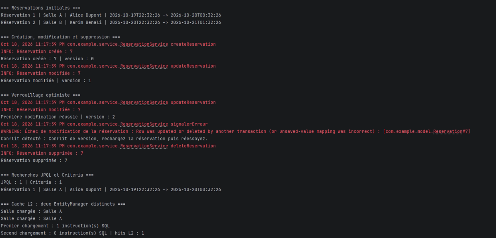
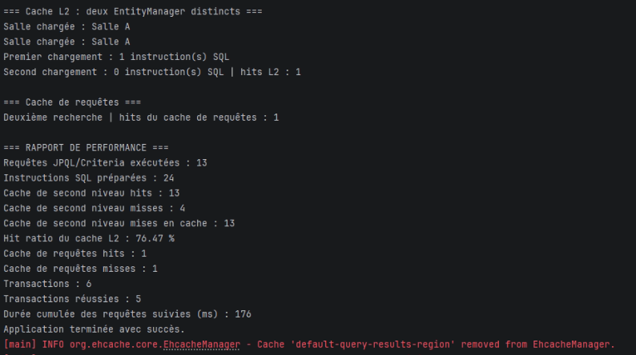
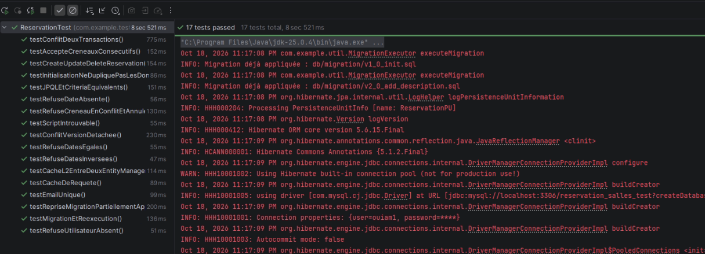

# TP Capstone — Réservation de salles avec JPA et Hibernate

L'application affiche les réservations, puis crée et modifie une réservation de démonstration. Sa version augmente à chaque modification. Une seconde modification utilisant une ancienne version est refusée par le verrouillage optimiste. La réservation est ensuite supprimée. Les recherches JPQL et Criteria retrouvent le même résultat.

Le premier chargement d'une salle exécute une instruction SQL. Le second chargement, dans un autre `EntityManager`, utilise le cache L2 sans accès SQL. Le cache de requêtes est également utilisé. Le rapport affiche les statistiques Hibernate : requêtes, hits et misses du cache, transactions et durée cumulée des requêtes. L'application se termine avec succès.

Les 17 tests JUnit réussissent, sans échec ni erreur. Ils vérifient la création, la modification et la suppression des réservations, les dates invalides, les conflits de créneaux et de versions, les recherches, les caches, l'initialisation des données et les migrations SQL.
